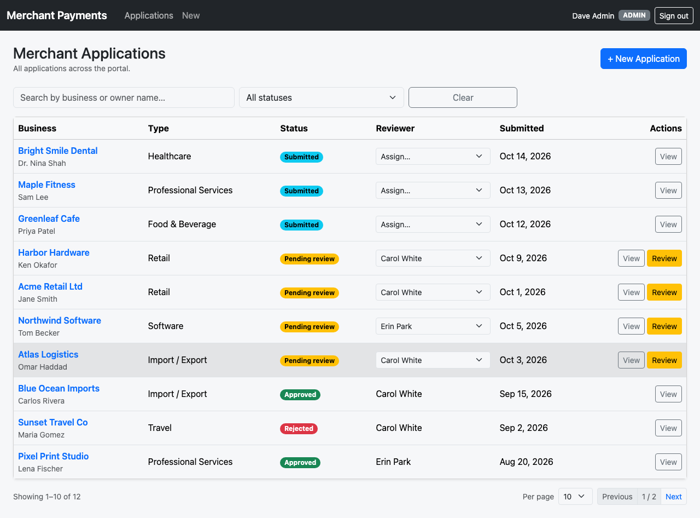

# Merchant Payments Portal

A small Angular 21 app for onboarding merchants. Sales people submit applications, reviewers approve or reject them, and admins assign reviewers. It runs against a local mock API.



## Running it locally

You need Node 20.19+, 22.12+ or 24+.

```bash
npm install
```

Then open two terminals:

```bash
# terminal 1 - mock API on http://localhost:3000
npm run mock-api

# terminal 2 - app on http://localhost:4200
npm start
```

Open http://localhost:4200 and log in with one of the accounts below.

Other commands:

```bash
npm test          # run unit tests once
npm run test:watch
npm run build     # production build into dist/
```

A few notes:
- The Angular dev server proxies `/api` to port 3000 (`proxy.conf.json`), so both need to be running.
- The mock API resets its data on every restart. It copies `mock-api/db.json` into `mock-api/.data/`, which is git-ignored.
- If `npm install` fails with `Cannot read properties of null (reading 'edgesOut')`, that's an npm 10.9 bug. Run `npx npm@11 install` instead.
- To try the token refresh, start the API with a short token life: `ACCESS_TOKEN_TTL=15s npm run mock-api`. Wait 15 seconds after logging in, then reload. In the Network tab you'll see the 401s, a single `/auth/refresh` call, and the original requests retried.

## Login accounts

These are fake users from `mock-api/db.json`. **Any password works.** You can also click the account buttons on the login page.

| Email | Role | Can do |
|---|---|---|
| `alice@portal.example` | SALES | See own applications, create new ones |
| `bob@portal.example` | SALES | Same as Alice, with different applications |
| `carol@portal.example` | REVIEWER | See assigned applications, reveal sensitive fields, approve or reject |
| `erin@portal.example` | REVIEWER | Same as Carol, with different assignments |
| `dave@portal.example` | ADMIN | See everything, assign reviewers, review, create |

No real credentials or API keys are used anywhere. The JWT signing key in the mock server (`DEV_SECRET`) is for local use only. You can override it with `MOCK_JWT_SECRET`.

## Project layout

```
mock-api/            db.json (seed data) + server.js (auth + endpoints)
src/app/core/        auth service, interceptor, guards, models, services
src/app/features/    login, dashboard, application-wizard, application-detail
src/app/shared/      masked-field, status-badge, loading-state, validators
```

## Architecture notes

**Signals + RxJS.** Signals hold the plain UI state: the current user, filters, page number, loading flags and the wizard step. RxJS handles anything async where timing matters. For example, the dashboard turns its filters into a stream and uses `switchMap`, so a slow old response can't overwrite a newer one. Search is debounced by 300 ms. The app is zoneless.

**Draft auto-save.** All four wizard steps write into forms owned by the parent component, so nothing is lost when you move between steps. Changes from every step are merged, debounced by 1.5 s, and saved with `concatMap`, so saves reach the server in order. Each user has one draft (`PUT /api/drafts/mine`), and it's restored when the wizard opens. Sensitive fields (SSN, tax ID, bank details) are never put in a draft.

**Token refresh on concurrent 401s.** The brief's sample used an `isRefreshing` flag and a `BehaviorSubject`. That works until the refresh itself fails: the waiting requests then hang forever, because the subject never gets a token. I kept the same idea (one refresh, everyone else waits for it) but used a shared observable (`shareReplay`) in `AuthService` instead. Every 401 asks for the same in-flight refresh, so only one call is made. When it succeeds, every waiting request is retried with the new token. When it fails, every request gets the error and the user is logged out once. A request is only retried once, so it can't loop.

**Permissions.** The route guards and `@if` checks are for the UI. The mock API enforces the real rules:
- SALES only sees their own applications, reviewers only see the ones assigned to them, and admins see all.
- Only reviewers and admins can submit a review.
- An application that isn't yours returns 404.

I didn't mount JSON Server's default routes, because they would let anyone edit any record. Every endpoint is written out explicitly.

## Security notes

- **CSP.** The policy is in `src/index.html`, and the dev server also sends it as a header.
  - `script-src 'self'` only allows scripts from our own origin. Injected `<script>` tags, inline scripts and `onerror=` handlers are all blocked.
  - `frame-ancestors 'none'` stops other sites from embedding the app in an iframe, which is how clickjacking works. Browsers ignore this directive in a meta tag, which is why it's also sent as a header.
  - `connect-src 'self'` works because the API is proxied.
  - `style-src` needs `'unsafe-inline'` because Angular adds component styles at runtime.
- **sessionStorage instead of localStorage.** Tokens stay in one tab and disappear when it closes. An XSS bug could still read them, but they don't stick around on a shared machine or leak into other tabs. In production I'd put the refresh token in an HttpOnly cookie instead.
- **Masking.** Sensitive fields are masked on screen, and only reviewers and admins get a Reveal button; for SALES the button isn't in the DOM. The real protection is on the server: SALES users only ever receive the last 4 digits, and never the SSN. Masking in the browser only helps against people looking over your shoulder or at screenshots.
- **Test data.** All data is fake: `.example` emails, 555 phone numbers, and SSNs in a range that's never issued.

## Tests

`npm test` runs 81 tests using Vitest and Angular TestBed:
- the auth service
- the interceptor, including the concurrent-401 case
- the masked field
- the validators
- the dashboard
- the detail page
- the wizard

I also clicked through the app as each user in a headless browser to check what each role can and can't see.

## AI disclosure

I used Claude Code (Claude Opus) to help write the code, tests and docs. I checked the output by running the tests and the production build, testing the API rules with curl, and walking through the app as each role. That walkthrough caught a couple of bugs, which I fixed.

## Known limitations

- Tokens in sessionStorage can still be read by XSS. An HttpOnly cookie would be better.
- The mock API is basic. It keeps revoked tokens in memory, has no rate limiting, and stores data in a plain JSON file.
- The CSP header is only sent by the dev server. Production hosting would need to send the same header.
- Bootstrap is included as full CSS, which makes the initial bundle about 516 kB (about 100 kB gzipped).
- You have to re-enter sensitive fields after restoring a draft. That's on purpose.
- There's no "unsaved changes" warning when leaving the wizard.
- No end-to-end tests are committed, only unit and component tests.
# merchant-payment-portal
